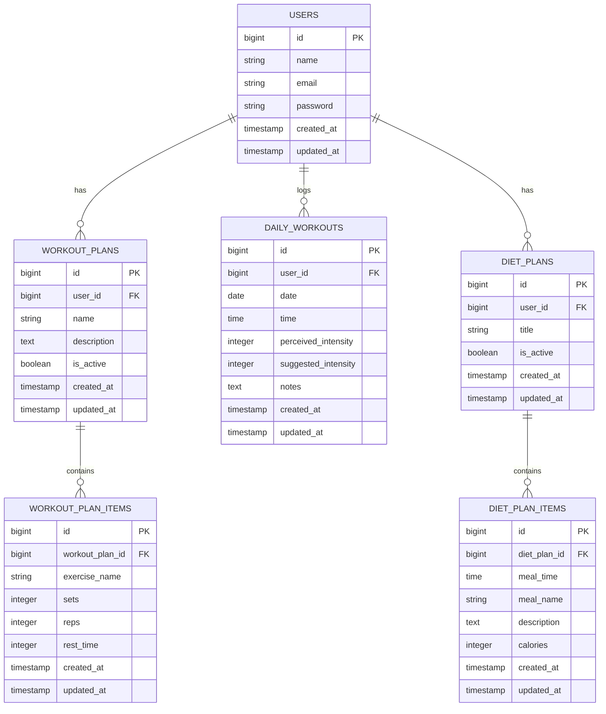

# Keep-Training

O **Keep-Training** é uma aplicação PWA (Progressive Web App) desenvolvida para simplificar e focar no registro de treinos diários, gestão de fichas de exercícios e acompanhamento de dieta. A interface foi pensada com uma abordagem mobile-first, inspirada na dinâmica de aplicativos esportivos focados em performance, apresentando alto contraste com o uso de preto absoluto e cores vibrantes de destaque.

## Funcionalidades Principais

* **Registro de Treino Diário:** Permite registrar um ou múltiplos treinos no mesmo dia, incluindo a percepção de intensidade.
* **Fichas de Treino:** Criação de planos de exercícios detalhados (séries, repetições, descanso).
* **Fichas de Dieta:** Estruturação de planos alimentares divididos por refeições.
* **Experiência PWA:** Instalável diretamente na tela inicial do celular, comportando-se como um aplicativo nativo.

## Stack Tecnológico

* **Framework:** Laravel 13
* **Painel e UI:** Filament (TALL Stack - Tailwind CSS, Alpine.js, Laravel, Livewire)
* **Banco de Dados:** SQLite

## Diagrama do Banco de Dados



## Como Iniciar o Projeto (Ambiente Local)

Pré-requisitos: PHP 8.2+, Composer e Node.js.

```bash
git clone https://github.com/seu-usuario/keep-training.git
cd keep-training
composer install
cp .env.example .env
php artisan key:generate
touch database/database.sqlite
php artisan migrate
php artisan filament:install --panels
php artisan serve
```

## Configuração do Filament e PWA

Certifique-se de configurar a paleta de cores no painel do Filament em `app/Providers/Filament/AdminPanelProvider.php`:

```php
use Filament\Support\Colors\Color;

$panel->colors([
    'primary' => Color::hex('#FF6D1D'),
    'warning' => Color::hex('#FFA518'),
    'gray' => Color::hex('#E1DEDE'),
    'black' => Color::hex('#000000'),
]);
```

Para a configuração do PWA, utilize um pacote como o `ladumor/laravel-pwa` e publique os assets.

```bash
composer require ladumor/laravel-pwa
php artisan laravel-pwa:publish
```
